# Panel administracyjny — instrukcja

Instrukcja dla osób, które prowadzą stronę zbudowaną na starterze: administratora i redaktora. Opisuje, co można zmienić w panelu `/admin`, kto może to zrobić i jak. Zrzuty ekranów pochodzą z lokalnego demo („Pracownia Nowak”, `make fresh`) i z panelu w języku polskim; u klienta nazwy i treści będą inne, układ ekranów ten sam.

## Spis treści

- [Logowanie i konto](#logowanie-i-konto)
- [Role i uprawnienia](#role-i-uprawnienia)
- [Pulpit](#pulpit)
- [Wyszukiwanie i zapisane widoki](#wyszukiwanie-i-zapisane-widoki)
- [Strona główna](#strona-główna)
- [Strony](#strony)
- [Artykuły](#artykuły)
- [Tagi](#tagi)
- [FAQ](#faq)
- [Import CSV](#import-csv)
- [Media](#media)
- [Nawigacja](#nawigacja)
- [Kosz](#kosz)
- [Kontakt — wiadomości](#kontakt--wiadomości)
- [Formularze kontaktowe](#formularze-kontaktowe)
- [Ustawienia strony](#ustawienia-strony)
- [Stan techniczny i start strony](#stan-techniczny-i-start-strony)
- [Użytkownicy](#użytkownicy)
- [Dziennik audytu](#dziennik-audytu)
- [Czego nie zrobisz w panelu](#czego-nie-zrobisz-w-panelu)

## Logowanie i konto

1. Wejdź na `/login` i zaloguj się e-mailem i hasłem. Nowe konto dostaje zaproszenie mailem z linkiem do ustawienia hasła (patrz [Użytkownicy](#użytkownicy)); samodzielna rejestracja jest domyślnie wyłączona.
2. Po zalogowaniu osoba z rolą przechodzi do `/admin`. Konto bez roli trafia na stronę główną, a panel odpowiada mu błędem 403.
3. **Ustawienia konta** (link na dole menu panelu) mają zakładki:
   - **Profil** — imię i nazwisko, e-mail, usunięcie własnego konta,
   - **Bezpieczeństwo** — zmiana hasła, logowanie dwuetapowe (2FA, kody z aplikacji typu Authenticator i kody zapasowe) oraz klucze dostępu (passkeys); przed wejściem panel prosi o potwierdzenie hasła,
   - **Wygląd** — jasny, ciemny lub systemowy motyw panelu.
   Język panelu zmienisz przełącznikiem języka w nagłówku ustawień konta.

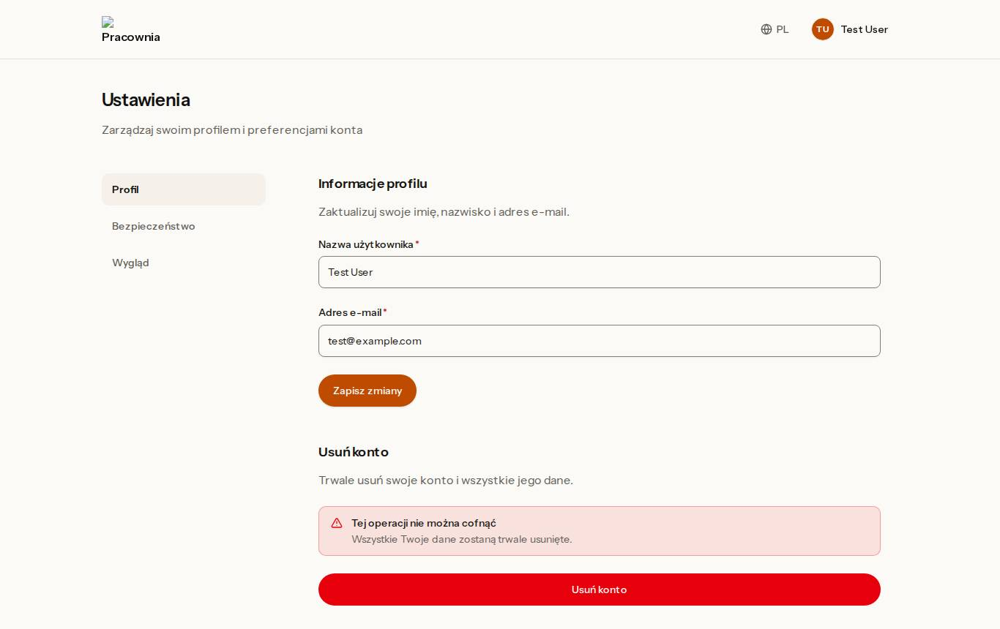

> Administratorzy powinni włączyć 2FA. Na produkcji `ADMIN_REQUIRE_TWO_FACTOR=true` czyni je obowiązkowym; pulpit i lista kontrolna startu pokazują administratorów bez 2FA.

## Role i uprawnienia

Są trzy stałe role. Rolę nadaje administrator w module [Użytkownicy](#użytkownicy).

| Moduł | Administrator | Redaktor | Podgląd (tylko odczyt) |
|---|---|---|---|
| Pulpit, wyszukiwanie, podgląd szkiców | ✓ | ✓ | ✓ |
| Strona główna — edycja sekcji, widoczność, kolejność | ✓ | ✓ | podgląd |
| Strony, artykuły — tworzenie, edycja, publikacja | ✓ | ✓ | podgląd |
| Strony, artykuły — usuwanie, kosz | ✓ | — | — |
| Tagi, FAQ — tworzenie i edycja | ✓ | ✓ | podgląd |
| Tagi, FAQ — usuwanie, import CSV | ✓ | — | — |
| Media — przesyłanie, tekst alternatywny | ✓ | ✓ | podgląd |
| Media — usuwanie | ✓ | — | — |
| Nawigacja — wszystko | ✓ | ✓ | podgląd |
| Kontakt — czytanie wiadomości | ✓ | ✓ | — |
| Kontakt — ponowna wysyłka, usuwanie, eksport CSV | ✓ | — | — |
| Formularze kontaktowe | ✓ | — | — |
| Ustawienia strony, stan techniczny, start strony | ✓ | — | — |
| Użytkownicy, dziennik audytu | ✓ | — | — |

Operacje spoza uprawnień roli są w panelu niedostępne, a serwer i tak je odrzuca.

> **Uwaga przy testach lokalnych:** w środowisku `local` każde zalogowane konto ma pełne prawa administratora. Ograniczenia ról sprawdzaj na stagingu.

## Pulpit

Pierwszy ekran panelu: liczba wiadomości z formularza, opublikowanych i zaplanowanych artykułów, plików do przejrzenia, lista „Wymaga uwagi” (np. niedostarczone wiadomości, pliki odrzucone przez skaner, administratorzy bez 2FA), wykres wiadomości dziennie (przycisk **Pokaż jako tabelę** dla czytników ekranu), stan treści i ostatnie zmiany. Przyciski **Nowy artykuł** i **Nowa strona** prowadzą prosto do formularzy.

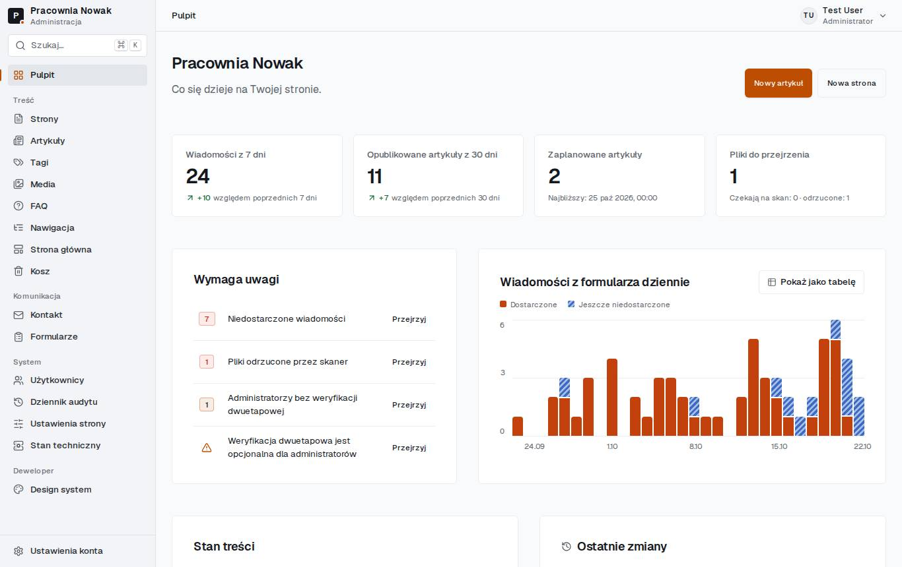

## Wyszukiwanie i zapisane widoki

- **⌘K / Ctrl+K** albo pole **Szukaj…** w menu otwiera paletę: przejście do modułu oraz wyszukiwanie stron, artykułów, tagów, FAQ, mediów i (dla administratora) użytkowników. Wyniki uwzględniają uprawnienia roli.
- Listy (strony, artykuły, FAQ, media, kontakt, dziennik) mają filtry, sortowanie i paginację. Przycisk **Widoki** zapisuje bieżący zestaw filtrów pod nazwą, żeby wracać do niego jednym kliknięciem.

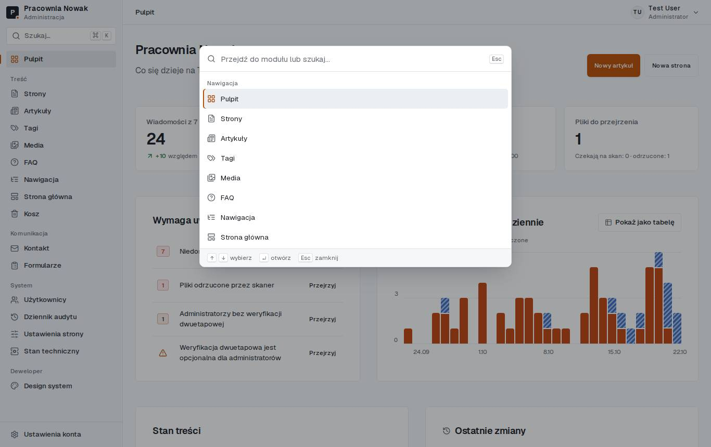

## Strona główna

Strona główna składa się z gotowych sekcji. W każdym języku masz własne treści, widoczność i kolejność.

Dostępne sekcje: **Baner główny**, **Funkcje**, **Portfolio**, **Zespół**, **Cennik**, **Opinie**, **FAQ**, **Najnowsze artykuły**, **Wezwanie do działania**, **Formularz kontaktowy**. Każda sekcja występuje raz; nowych typów sekcji nie dodasz w panelu.

1. Otwórz **Strona główna** i wybierz **Język**.
2. **Kolejność:** w bloku „Kolejność sekcji” przesuwaj sekcje strzałkami w górę i w dół; zmiana zapisuje się od razu.
3. **Widoczność:** w tabeli sekcji przełącznik „Pokazuj … na stronie głównej” ukrywa lub pokazuje sekcję.
4. **Treść:** kliknij nazwę sekcji. Pola zależą od typu, np. baner ma nadtytuł, nagłówek, opis, obraz z biblioteki, do 4 liczb (statystyk) i dwa przyciski z wyborem celu (formularz, lista artykułów, strona, sekcja). Sekcje z elementami (funkcje, realizacje, osoby, pakiety, opinie) mają przycisk **Dodaj…** i limit elementów.
5. Kliknij **Zapisz**. Pod formularzem jest **Historia zmian** tej sekcji.

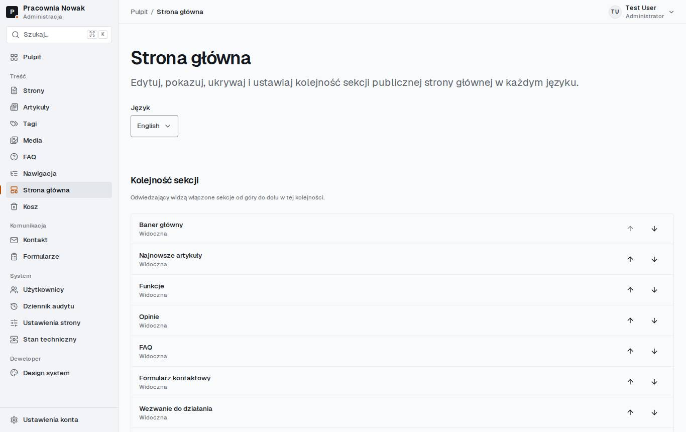
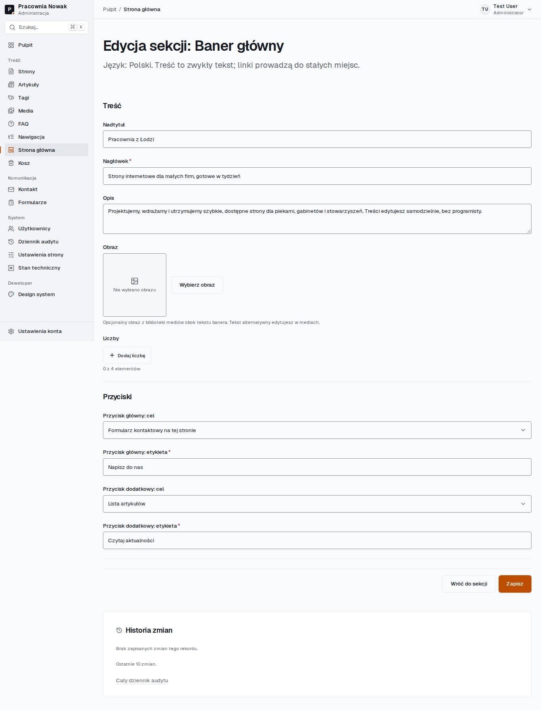

Treść sekcji to zwykły tekst; formatowanie, kolory i układ wynikają z design systemu.

## Strony

Strony treści serwisu (np. „O nas”, „Usługi”, polityka prywatności) pod adresem `/{slug}` w każdym języku.

1. **Strony → Nowa strona** (albo kliknij istniejącą).
2. Zakładki u góry to języki. Język domyślny jest wymagany, pozostałe opcjonalne — pusty tytuł oznacza brak tej wersji językowej.
3. Wypełnij **Tytuł**, **Slug** (małe litery, cyfry i myślniki, np. `polityka-prywatnosci`), **Opis meta** (dla wyszukiwarek, do 320 znaków) i **Treść** w edytorze (nagłówki, listy, cytaty, linki, obrazy z biblioteki mediów).
4. Ustaw **Status**: *Szkic* (niewidoczny publicznie) albo *Opublikowana*.
5. **Zapisz zmiany**. Przy edycji **Podgląd: <język>** otwiera ostatnio zapisaną wersję w nowej karcie, także szkic (podgląd nie trafia do wyszukiwarek).

Zmiana sluga opublikowanej strony tworzy automatyczne przekierowanie 301 ze starego adresu. Administrator usuwa stronę przyciskiem **Usuń stronę** — trafia ona do [kosza](#kosz). Edycja jest chroniona przed nadpisaniem: jeśli ktoś zapisał stronę w międzyczasie, panel pokaże konflikt zamiast nadpisać jego zmiany.

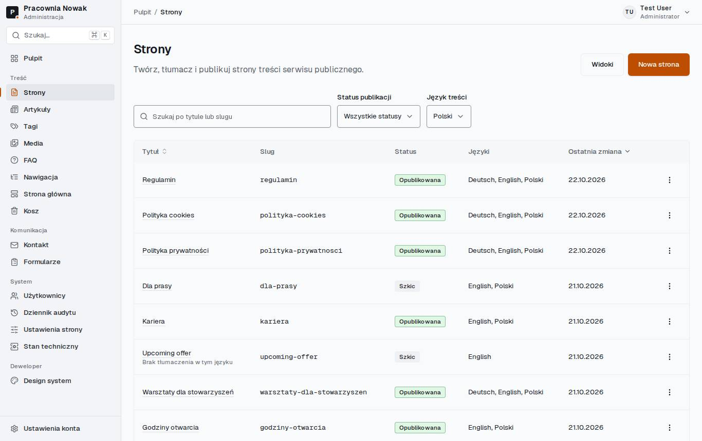
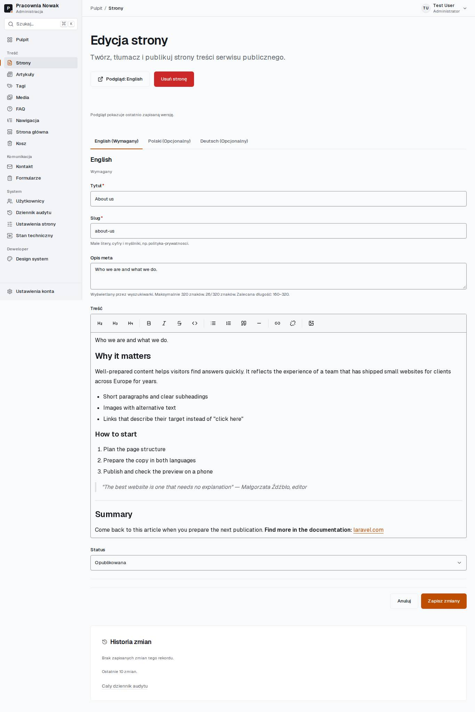

## Artykuły

Blog / aktualności pod `/articles`. Formularz jak przy stronach, z dodatkami:

1. **Artykuły → Nowy artykuł**.
2. Dla każdego języka: **Tytuł**, **Slug**, **Zajawka** (na liście artykułów, do 500 znaków), **Opis meta** (gdy pusty — używana jest zajawka), **Treść**, **Status**.
3. **Data publikacji:** puste pole = publikacja od razu; przyszła data **planuje** publikację (artykuł pojawi się sam o tej dacie, a do tego czasu ma status „Zaplanowany”).
4. **Okładka** i **Tagi** są wspólne dla wszystkich języków.
5. **Zapisz zmiany**, sprawdź **Podgląd**.

Lista ma filtr statusu (opublikowane / zaplanowane / szkice) i języka treści.

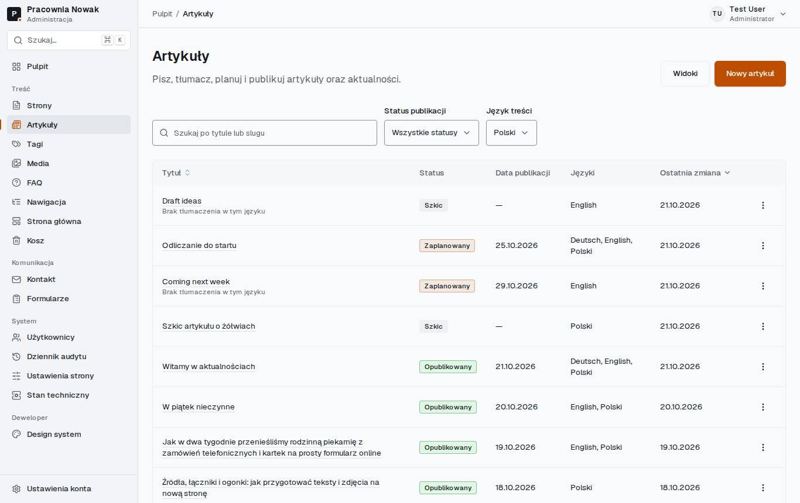
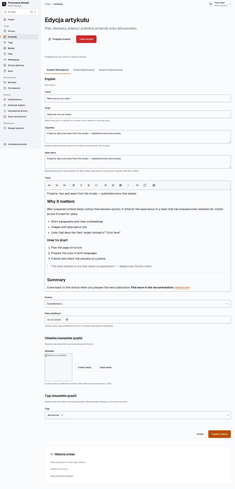

## Tagi

Kategorie artykułów, po których odwiedzający filtrują listę artykułów.

1. **Tagi → Dodaj tag**, wpisz nazwę w każdym języku i adres filtra (np. `poradniki`).
2. Przypisujesz je w formularzu artykułu.
3. Administrator może usuwać tagi i importować je z CSV ([Import CSV](#import-csv)).

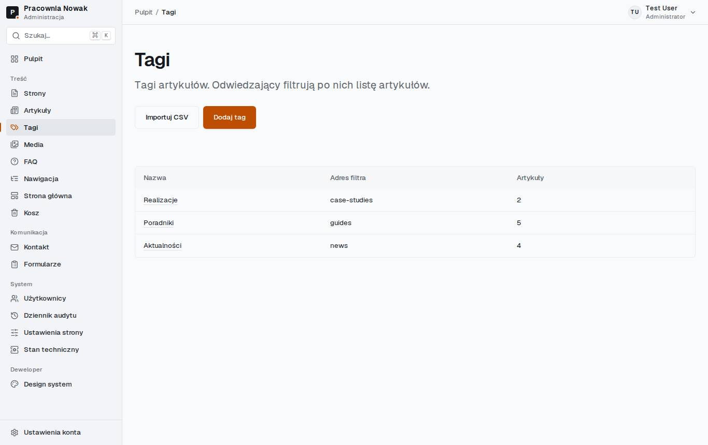

## FAQ

Pytania i odpowiedzi wyświetlane w sekcji FAQ strony głównej.

1. **FAQ → Dodaj pytanie**: pytanie, odpowiedź, język (albo wszystkie), kolejność i przełącznik „Opublikowane”.
2. Filtr „Opublikowane” na liście pokazuje tylko widoczne pytania.
3. Administrator usuwa pytania i importuje je z CSV.

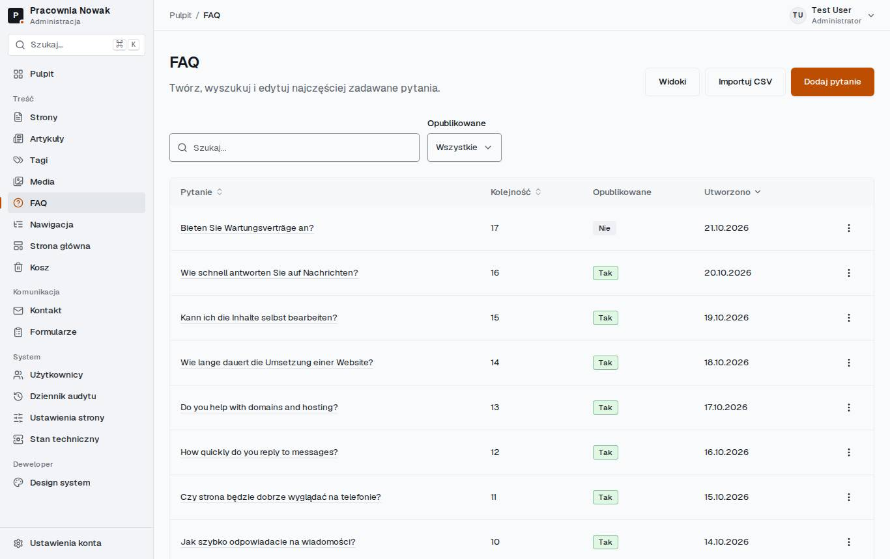

## Import CSV

Dostępny dla administratora w FAQ i tagach (**Importuj CSV**).

1. Przygotuj plik CSV w UTF-8 (przecinek lub średnik, do 1000 wierszy, do 2 MB). Pierwszy wiersz to nagłówki; ekran importu pokazuje wymagane kolumny (dla FAQ: `question`, `answer`, opcjonalnie `locale`, `position`, `published`).
2. **Wybierz plik** — panel sprawdza każdy wiersz i pokazuje podgląd z błędami.
3. Dopiero po potwierdzeniu dane są zapisywane. Nic nie trafi do bazy, dopóki nie zatwierdzisz importu.

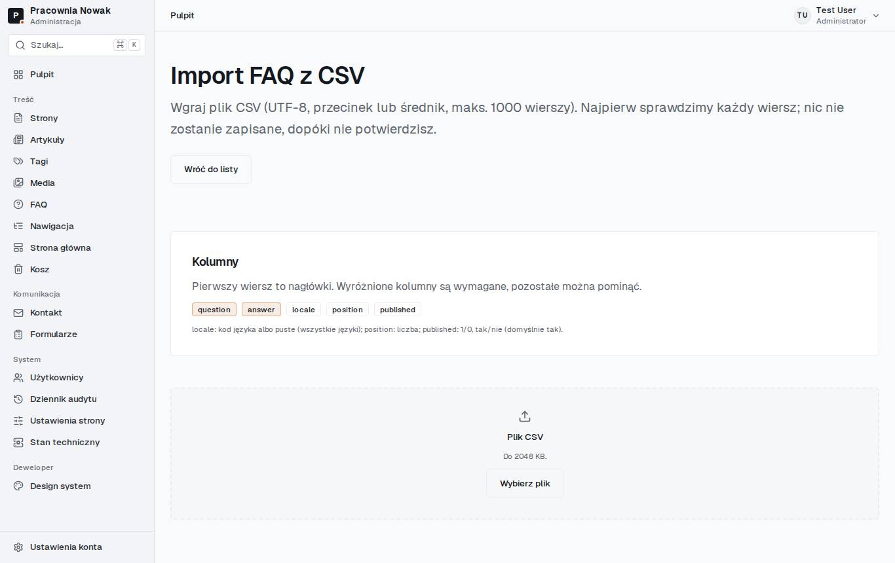

## Media

Biblioteka obrazów i dokumentów używanych na stronie (logo, okładki, zdjęcia w treści, obrazy sekcji).

1. **Media → Prześlij pliki**: przeciągnij pliki albo **Wybierz pliki**. Dozwolone: JPEG, PNG, WebP, AVIF i PDF, do 50 MB każdy. Typ jest sprawdzany po zawartości pliku, nie po rozszerzeniu.
2. Plik trafia najpierw do kwarantanny. Gdy skaner antywirusowy jest włączony, staje się dostępny („Czysty”) po pozytywnym skanie albo zostaje „Odrzucony”. Bez skanera (ustawienie serwera) plik jest od razu oznaczany jako czysty, a dziennik zapisuje pominięcie skanu.
3. Kliknij plik, aby uzupełnić **Tekst alternatywny** (opis dla czytników ekranu i wyszukiwarek; zostaw pusty tylko dla obrazów dekoracyjnych) i **Zapisz**. Lista oznacza obrazy bez tekstu alternatywnego.
4. Dla obrazów panel sam tworzy lżejsze warianty (AVIF, WebP, JPEG w kilku rozmiarach).
5. Administrator usuwa plik przyciskiem **Usuń**. Artykuł, którego okładkę usunięto, zostaje bez okładki.

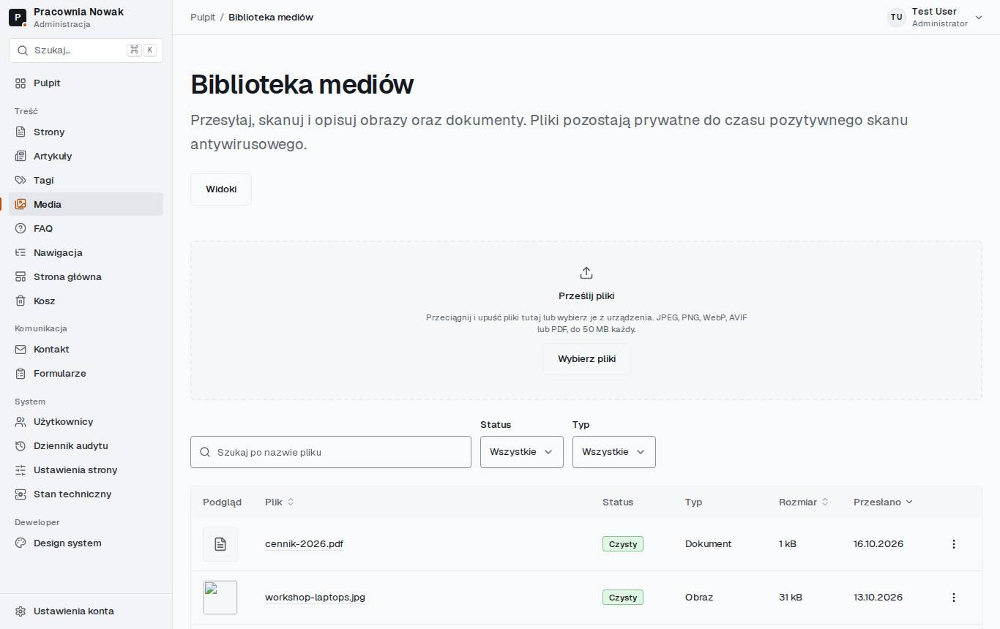
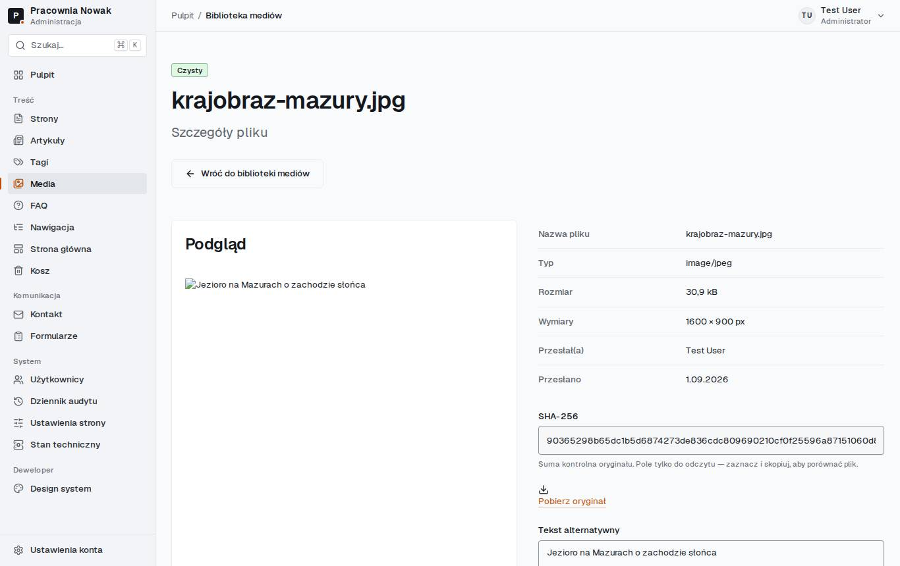

## Nawigacja

Menu w nagłówku i stopce, osobno dla każdego języka.

1. **Nawigacja**: wybierz **Menu** (Nagłówek / Stopka) i **Język**.
2. **Nowa pozycja menu** → **Typ**:
   - *Strona* lub *Artykuł* — wybierasz z listy; etykieta może zostać pusta (użyty będzie tytuł),
   - *Lista artykułów*, *Kotwica* (sekcja strony głównej, np. kontakt),
   - *Link zewnętrzny* — pełny adres `https://`, opcjonalnie otwierany w nowej karcie,
   - *Nagłówek grupy* — rozwijane podmenu.
3. **Pozycja nadrzędna** wkłada pozycję do grupy (menu ma dwa poziomy).
4. **Kolejność** zmieniasz strzałkami w bloku „Kolejność”; zapisuje się od razu. **Edytuj** przy pozycji pozwala ją zmienić, ukryć albo usunąć.

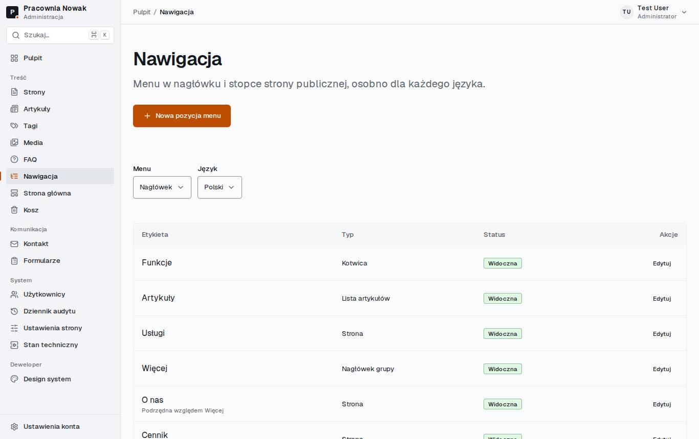
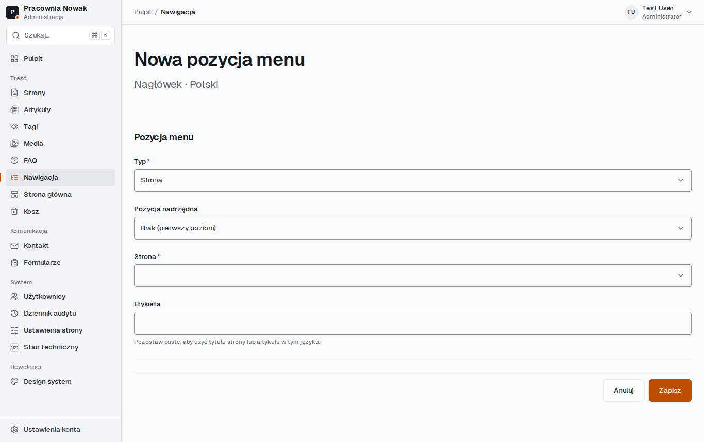

## Kosz

Usunięte strony i artykuły trafiają do kosza i znikają na stałe po 30 dniach (zadanie codzienne).

- **Przywróć** — strona lub artykuł wraca z poprzednim statusem.
- **Usuń na stałe** — natychmiast i bez możliwości cofnięcia.

Kosz widzi i obsługuje tylko administrator. Pliki mediów i inne rekordy (tagi, FAQ, pozycje menu) nie trafiają do kosza — ich usunięcie jest ostateczne.

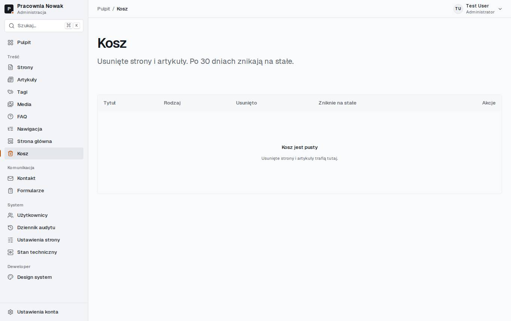

## Kontakt — wiadomości

Wiadomości z formularzy kontaktowych strony i status ich dostarczenia mailem do odbiorców z [ustawień strony](#ustawienia-strony).

- Statusy: *Oczekuje* (w kolejce wysyłki), *Wysłano*, *Niepowodzenie* (po wyczerpaniu prób).
- Kliknij wiadomość, aby zobaczyć treść, dane nadawcy, liczbę prób i ostatni błąd.
- Administrator: **Ponów wysyłkę** dla nieudanych, **Usuń**, **Eksport CSV** oraz zaznaczanie wielu wierszy na liście.
- Wiadomości są automatycznie usuwane po okresie przechowywania (RODO, ustawienie serwera).

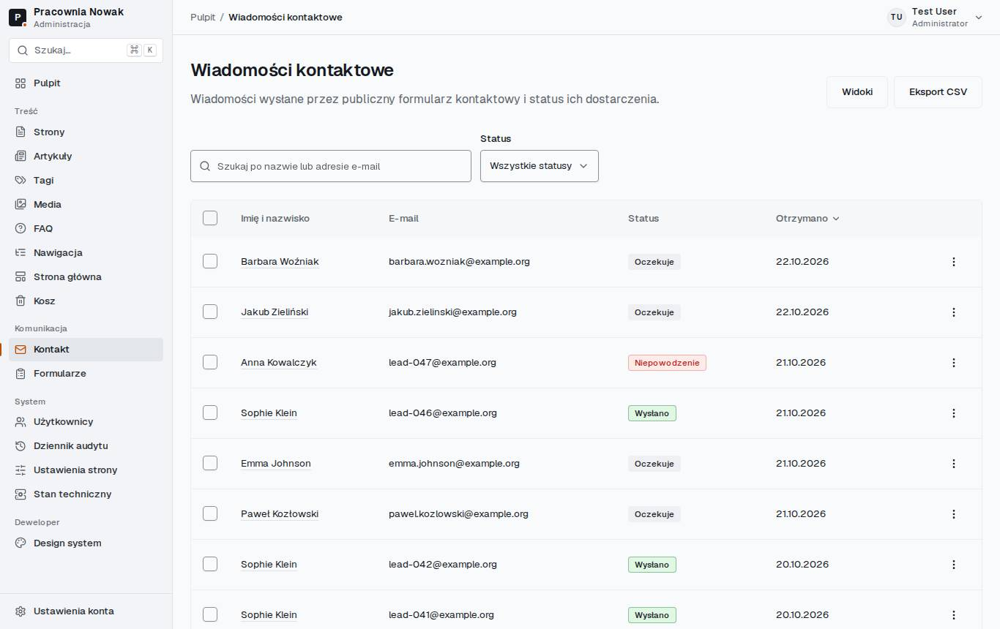
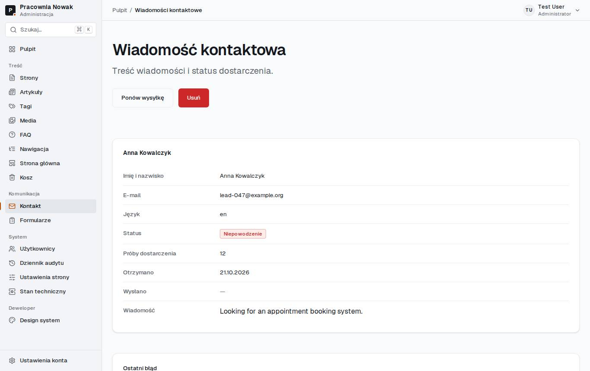

## Formularze kontaktowe

Administrator może mieć kilka formularzy (np. „Napisz do nas” i „Zapytaj o wycenę”). Każdy zawsze ma imię, e-mail i wiadomość; możesz dodać własne pola.

1. **Formularze → Nowy formularz** (albo edytuj istniejący).
2. **Klucz** (np. `quote`), przełącznik **Aktywny**, **Tytuł** w każdym języku.
3. **Pola dodatkowe → Dodaj pole** — do 20 pól wyświetlanych po wiadomości.
4. **Zapisz formularz**. Formularz pokazywany na stronie wybierasz w sekcji „Formularz kontaktowy” [strony głównej](#strona-główna).

Formularza domyślnego (`contact`) nie można usunąć.

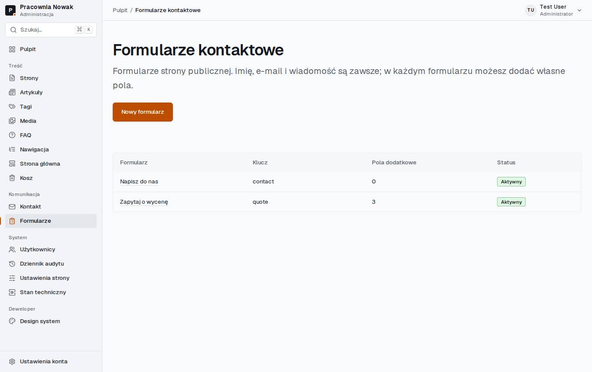
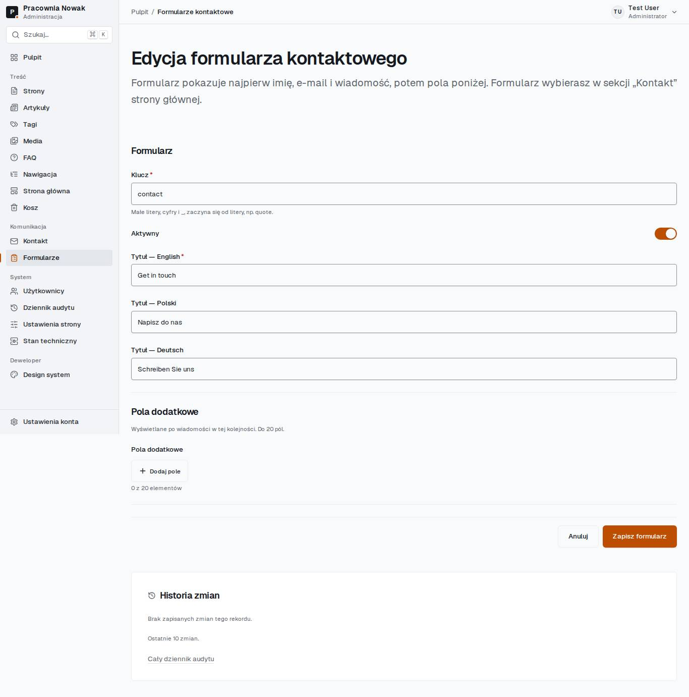

## Ustawienia strony

Tylko administrator. Jeden formularz z kilkoma blokami; zakładki języków u góry dotyczą bloku tekstów.

- **Ogólne** — nazwa strony (nie jest tłumaczona) i logo z biblioteki mediów (bez logo wyświetlana jest nazwa).
- **Wygląd** — kolor akcentu (pomarańczowy, niebieski, fioletowy, różowy, zielony; każdy zachowuje czytelny kontrast), krój nagłówków (nowoczesny lub klasyczny szeryfowy), domyślny motyw (jak w urządzeniu / jasny / ciemny) i ikona w przeglądarce (favicon).
- **Dane kontaktowe** — e-mail, telefon, adres, kod kraju, NIP, link do mapy i godziny otwarcia (widoczne w stopce i dla wyszukiwarek).
- **Media społecznościowe** — adresy profili (tylko `https://`).
- **Obraz udostępniania** — domyślny obraz podglądu linku w mediach społecznościowych (1200×630 px) i token Google Search Console.
- **Teksty i wyszukiwarki** (per język) — hasło marki, tekst stopki, tytuł strony głównej, domyślny opis meta, treść automatycznej odpowiedzi.
- **Powiadomienia** — do 5 odbiorców wiadomości z formularza i przełącznik automatycznej odpowiedzi do nadawcy.

Kliknij **Zapisz ustawienia**. Każda zmiana trafia do dziennika audytu.

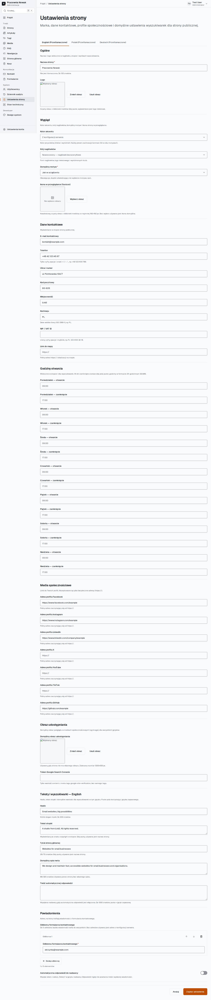

## Stan techniczny i start strony

Tylko administrator.

- **Publikacja** — przełącznik **Strona „wkrótce”** (goście widzą stronę zapowiedzi, zalogowani w panelu widzą całość) i **Ukryj cały serwis przed wyszukiwarkami** (noindex). Przed startem oba bywają włączone; po starcie wyłącz je i kliknij **Zapisz publikację**.
- **Lista kontrolna startu** — 2FA administratorów, testowy e-mail, token Google Search Console, opublikowane strony prawne.
- **Wyślij testowy e-mail** — sprawdza, czy poczta z serwera dochodzi.
- Pozostałe bloki są informacyjne: środowisko, baza, kolejka, wymóg 2FA, czas sesji, moduły.

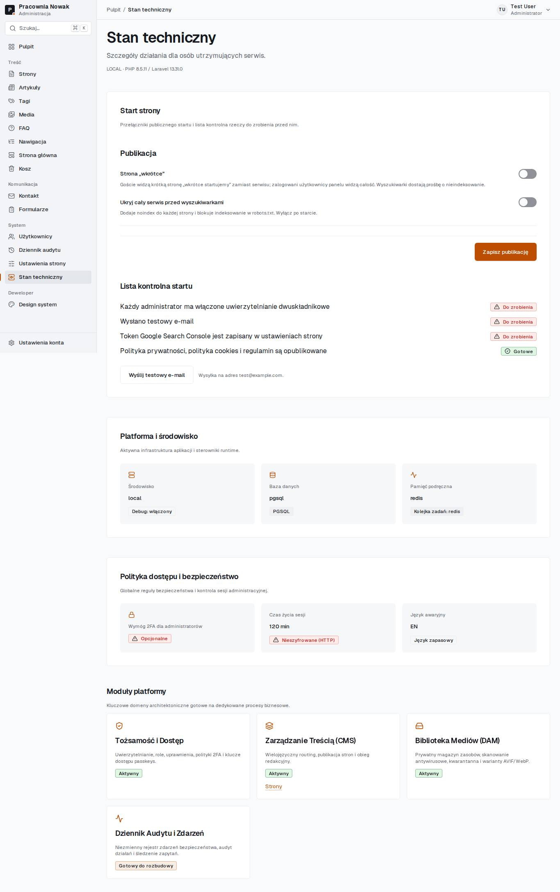

## Użytkownicy

Tylko administrator.

1. **Użytkownicy → Nowy użytkownik**: imię i nazwisko, e-mail i **Rola** (*Brak dostępu do panelu*, *Redaktor*, *Podgląd (tylko odczyt)*, *Administrator*).
2. Po zapisaniu na podany adres trafia zaproszenie z linkiem do ustawienia hasła.
3. Na liście możesz filtrować konta, edytować dane i rolę albo usunąć konto. Własnego konta administrator nie usunie z listy; panel nie pozwala też odebrać praw ostatniemu administratorowi.

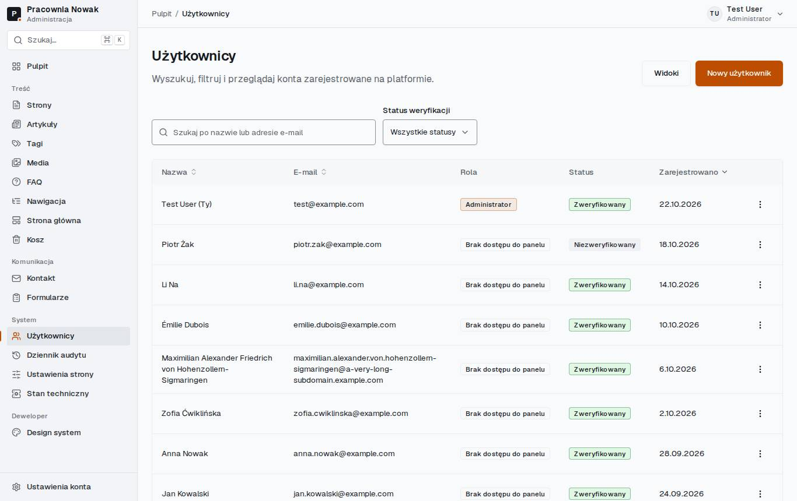
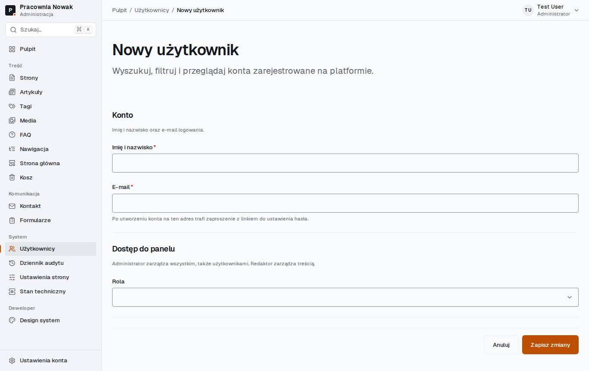

## Dziennik audytu

Tylko administrator. Historia zmian tylko do odczytu: kto, co, kiedy i które pola zmienił (wartości poufne, np. treść stron czy adresy odbiorców, są ukryte). Filtr **Akcja** zawęża listę. Każdy formularz edycji ma też blok **Historia zmian** z ostatnimi zmianami tego rekordu.

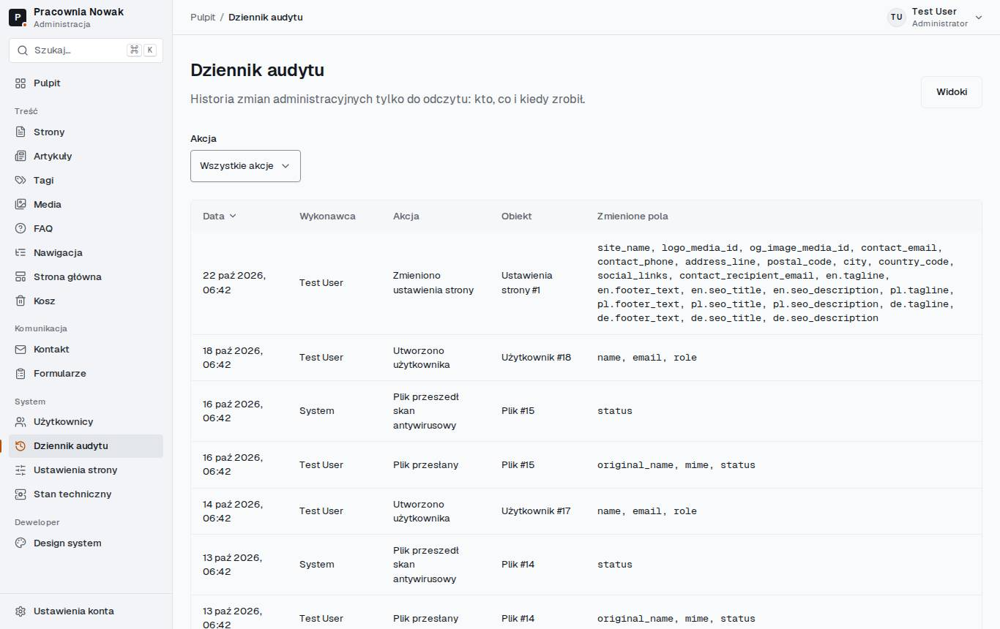

## Czego nie zrobisz w panelu

Te zmiany wymagają programisty (zmiana kodu) albo osoby utrzymującej serwer (konfiguracja `.env`):

- **Układ i wygląd** poza [ustawieniami](#ustawienia-strony): nowe typy sekcji, dodatkowe pola w sekcji, inny układ strony, własny CSS. Starter celowo nie ma kreatora stron (page buildera).
- **Języki serwisu** — lista języków publicznych, język domyślny i zapasowy.
- **Teksty interfejsu** — etykiety przycisków, komunikaty i treści stałe zapisane w plikach tłumaczeń.
- **Role i uprawnienia** — są trzy stałe role; nie da się tworzyć własnych ani zmieniać zakresu ról.
- **Poczta, domena, HTTPS, kopie zapasowe** — konfiguracja serwera.
- **Rejestracja publiczna** (`APP_REGISTRATION_ENABLED`), **skaner antywirusowy** (`MEDIA_SCANNER_ENABLED`), **wymóg 2FA** (`ADMIN_REQUIRE_TWO_FACTOR`), **analityka** (Plausible) i **okres przechowywania wiadomości**.
- **Przywracanie usuniętych** mediów, tagów, FAQ i pozycji menu — tylko strony i artykuły mają kosz.
- **Strony planowane** — data publikacji z wyprzedzeniem jest tylko w artykułach.

Pozycja **Design system** w sekcji „Deweloper” menu to katalog komponentów dla programistów; istnieje tylko lokalnie.
